  

---

## 🧑‍💻 About Me

I'm a **DevSecOps Engineer** based in **Lugano, Switzerland**. I moved from full-stack development to cloud-native infrastructure and never looked back.

- 🏅 **CKA · CKAD · KCNA · KCSA** · Sysdig Kraken Hunter · Snyk Certified Technical Professional
- 🔭 Running a **homelab Kubernetes cluster** where mistakes are welcome (it's called learning)
- 🤖 Running **local LLMs** (llama.cpp, Ollama) on an RTX 4070 Ti and a DGX Spark, and testing frontier models on real workflows
- 🎤 Speaker at **Linux Day Avellino 2024**
- 📝 Writing about DevOps, cloud-native, and AI at [alfonsofortunato.com](https://alfonsofortunato.com)

---

## 🛠️ Tech Stack

   
  

Also: Vault · ArgoCD · Trivy · Dagger · tmux · Ollama · Claude · LangChain

---

## 🚀 Featured Projects

| Project | Description | Stars |
|---------|-------------|:-----:|
| [devpod-dotfiles-chezmoi](https://github.com/MovieMaker93/devpod-dotfiles-chezmoi) | Cross-platform dotfiles for Zsh, Tmux, Neovim & Bitwarden — works on workstations, DevPods, and DevContainers | ⭐ 25 |
| [homelab-k8s](https://github.com/MovieMaker93/homelab-k8s) | My Homelab Kubernetes playground — where mistakes are the curriculum | ⭐ 3 |
| [note-cli](https://github.com/MovieMaker93/note-cli) | CLI for Zettelkasten-style notes, integrating Neovim & Obsidian | ⭐ 2 |
| [telescope-ghissue.nvim](https://github.com/MovieMaker93/telescope-ghissue.nvim) | Neovim Telescope plugin for browsing GitHub issues in-editor | ⭐ 1 |

---

## 📝 Latest from the Blog

<!-- BLOG-POST-LIST:START -->
- [Why I'm Betting on Local AI (and How You Can Start)](https://alfonsofortunato.com/blog/why-im-betting-on-local-ai/)
- [DeepSeek V4 Flash vs GLM 5.3 Flash: Who Wins on a Single Spark?](https://alfonsofortunato.com/blog/deepseek-v4-flash-vs-glm-5-3-flash-who-wins-on-a-single-spark/)
- [DeepSeek V4 Flash on a Single DGX Spark](https://alfonsofortunato.com/blog/deepseek-v4-flash-on-a-single-dgx-spark/)
- [Running Laguna S 2.1 on a DGX Spark](https://alfonsofortunato.com/blog/running-laguna-s2-1-on-dgx-spark/)
- [My Obsidian PKM Setup: Karpathy's LLM Wiki + Claude Code + Local Search](https://alfonsofortunato.com/blog/obsidian-pkm-llm-wiki/)
<!-- BLOG-POST-LIST:END -->

---

## 📊 GitHub Stats

  
  

